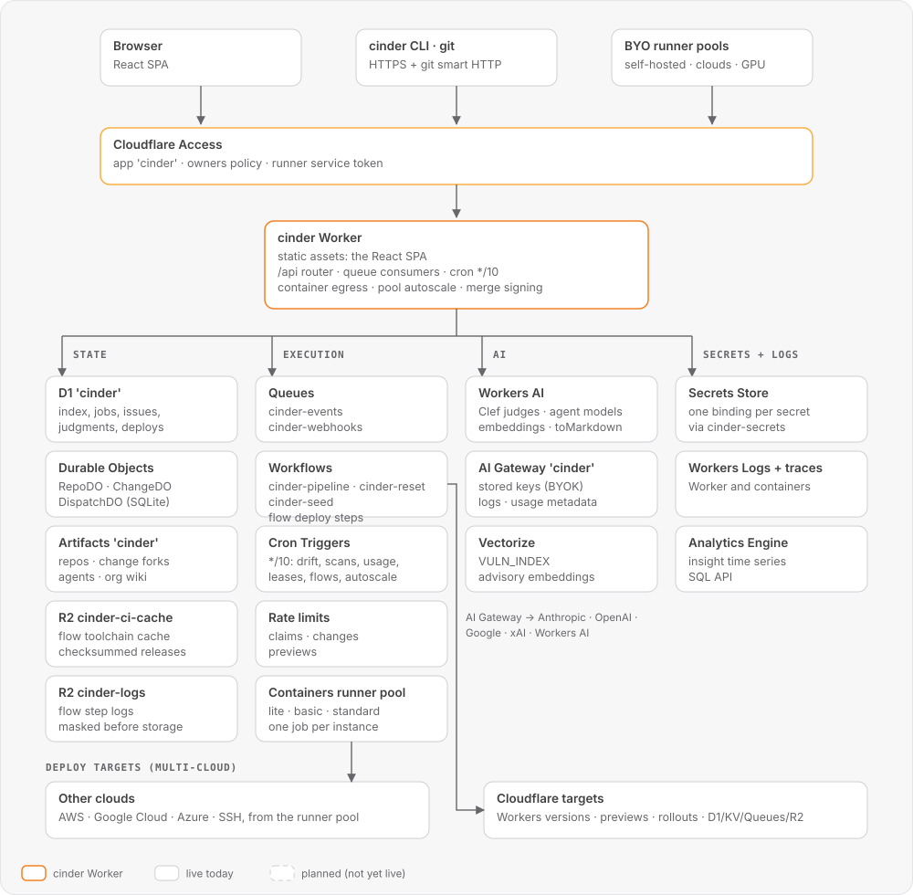

# Cinder on Cloudflare: architecture map

What cinder runs on: every binding, the Cloudflare resource behind each page and each background service, and the gaps that remain. Code claims cite files on `main`.

**Rules**
- Every page and service in cinder links to something deployed in Cloudflare. Cloudflare is the backing for all deployed resources: flow runners use ephemeral, auto-scaled containers, and git saves to storage or a database properly.
- Everything that backs cinder uses Cloudflare resources. The application never handles encryption, storage or anything like them itself.
- Cinder encrypts nothing directly, but values and secrets do need encryption. Secrets must never be exposed through logs or by any other means.

Other decisions this map applies: Flows stays cinder's own engine and deploys across clouds, and Cloudflare targets go through Workflows. The managed pool is Cloudflare Containers: one job per instance, started for queued work and stopped when idle. Personal model keys live only in My model access, and org keys live in AI Gateway Provider Keys.

---

## 0. Rules

- **Job compute:**
  - Runners are identical, ephemeral workers on Cloudflare Containers. Every instance starts from the same image and runs any job kind.
  - The pool autoscales from queue depth, down to zero when there's no work. It may keep a small warm buffer so a job is accepted fast.
  - An instance never carries state between jobs; how long it lives doesn't matter.
- **Merge signing:** the Worker signs merges server-side. The key lives in Secrets Store, bound to the Worker, and runners never see it. It signs only a merge commit whose tree is a verified tree in its merge job's batch; any other tree gets 409.
- **Multi-cloud deploy steps:**
  - Non-Cloudflare targets run inside the job's ephemeral worker, with the target's credentials read from the Keystore (Secrets Store) for the job's lease and masked in its output.
  - Cloudflare targets use Cloudflare Workflows.
- **Personal model keys:** the person's key is a Secrets Store secret. Runs route model calls through the account AI Gateway, which adds the stored key (chosen by the person's BYOK alias) and the person's metadata; the key never enters the container.
- **Secrets:** Secrets Store, one binding per secret, plus AI Gateway stored keys. Cinder never encrypts or stores values. Values are encrypted by Cloudflare and never exposed in logs or by any other means.
  - Keystore and webhook secrets are bound on a separate Worker, `cinder-secrets` (`worker/secrets/`), with no Durable Objects, containers, route or `workers.dev` URL. cinder reads a value through its `SECRETS` service binding (`read("KS_…")`). Each secret added or removed re-binds `cinder-secrets` with a settings PATCH (`keystore.js` `rebind`), which rolls a version of `cinder-secrets` only: cinder's Durable Objects and runner containers keep running, and no code path PATCHes cinder's settings or uploads cinder versions at runtime. `POST /api/keystore/rebind` re-binds them on demand after a deploy; otherwise a deploy that drops `KS_*` bindings (either Worker) is healed on the next secret read or webhook delivery, which re-binds and asks the caller to retry.
- **Vectorize:** build it properly. Reconcile creates the index, a scheduled job embeds advisories with Workers AI, and the judge queries the index.
- **Insights:** Workers Analytics Engine for time series, queried through its SQL API.
- **Wiki:**
  - There is one wiki per organization (account), stored as an org-level Artifacts git repo, so history, diff and restore come from git.
  - In the sidebar it is an org-level item, not a repo item.
- **AI Gateway:** the deploy token has AI Gateway Edit and Secrets Store Edit, and `deploy/reconcile.sh` creates the gateway on every release.

## 1. Architecture

The system overview below is generated by [`gen.py`](architecture/gen.py), with the job execution, git lifecycle, secrets and page diagrams in [docs/architecture](architecture/README.md).

<picture>
  <source media="(prefers-color-scheme: dark)" srcset="architecture/system-overview-dark.svg">
  
</picture>

### 1.1 Bindings: declared, used and live

| Product | `worker/wrangler.jsonc` | Code use | Live | Note |
|---|---|---|---|---|
| D1 `cinder` | `d1_databases` | everywhere | present | migrations in `worker/migrations/`; a fresh install applies them in one batch |
| DO RepoDO, ChangeDO, DispatchDO | `:19-20` | `index.js:22`, `changes.js:22`, `work.js:49` | present | SQLite-backed |
| Artifacts `cinder` | `:13` | `artifacts.js:7-48`, `git/index.js` | present | |
| R2 `cinder-ci-cache` | `r2_buckets` | `toolcache.js` via `TOOL_CACHE` (`BACKUP_BUCKET` is bound for `@cloudflare/ci`, which no live path starts) | present | Flow `setup:` toolchains under `toolcache/<tool>/<version>/release` with its SHA-256 in `release.sha256` (runner tokens holding a flow job that sets up that version, at most 512 MB each) |
| R2 `cinder-logs` | `:11` (`LOGS`) | `flow-logs.js`, `flow-results.js`, `flows.js`, `pipeline.js`, `admin.js` | present | Flow step logs under `flows/<run>/<job_key>/<idx>/<chunk>`: masked `<at> <text>` lines appended by the runner's numbered batches, whole lines per chunk, a new chunk past 256 KB, at most 50 MB per job (then one `##[warning]log truncated` line). Read by page, as `log.txt` and as `run.log` on subscribed sockets. A lifecycle rule set by `deploy/reconcile.sh` deletes `flows/` objects 30 days after they are written; a swept chunk answers `410 expired`. Flow artifacts under `artifacts/<run>/<job_key>/<name>` (≤ 100 MB, streamed from the runner), deleted by a second rule 30 days after upload |
| Containers CiSandbox, WorkerLite/Basic/Standard/Standard4 (bindings `WORKER_LITE`, `WORKER_BASIC`, `WORKER_STANDARD`, `WORKER_STANDARD4`) | `containers` | `index.js`, `workers.js` | present | One class per pool size. The Worker starts a pool worker per queued job up to the pool's max (`autoscale`), a worker runs one job and retires, an idle one stops past its keep-warm (`stopIfIdle`), and gone ones are pruned (`pruneGone`). CiSandbox is still bound and its container app deployed, but no live path starts it |
| Queues events, webhooks | `queues` | `pipeline.js`, `webhooks.js`, `index.js` | present | dead-letter queues `cinder-events-dlq` and `cinder-webhooks-dlq` |
| Workflow `cinder-reset` | `:16` | `admin.js` | present | nonprod reset, in batches |
| Workflow `cinder-seed` | `:16` | `admin.js` (`SeedWorkflow`) | present | nonprod reset-then-reseed and the demo scenario, through the Worker's own routes as the owner; sources bundled at build (`seed/bundle.mjs`) |
| Workflow `cinder-pipeline` | `workflows` | `pipeline.js`, `environments.js`, `releases.js`, `drift.js`, `flows.js` | present | A push instance hands the event to `cinder-events`; environment syncs, release promotes, drift self-heal and flow deploy steps start their own instances |
| Cron `*/10` + Artifacts push trigger | `:18` | `index.js:175` | present | |
| Rate limits | `:19` | `work.js:69`, `changes.js:283`, `edit.js:18`, `preview.js` | present | `CLAIM_LIMIT` per runner; `CHANGE_LIMIT` per person and repo; `PREVIEW_LIMIT` per person (each preview runs the risk judge) |
| Workers AI | `:14` | `s1/client.js`, `mirror.js`, `workers.js` (`models.internal`; `egress` converts HTML to Markdown with `toMarkdown`) | present | every call passes `{ gateway: { id: AI_GATEWAY_ID, metadata } }` |
| AI Gateway | `vars.AI_GATEWAY_ID` (`cinder`) | `usage.js` (`pullUsage`), `workers.js:23-31`, runner `harness.go`, `codex.go`, `opencode.go` | present | claude, codex and opencode `workers-ai` call through `CINDER_AI_GATEWAY` with `cf-aig-metadata`; managed workers reach it as `models.internal`, which the Worker forwards with `env.AI.gateway(AI_GATEWAY_ID).run(...)`, so no gateway token exists to set (`deploy/reconcile.sh` turns on gateway authentication, which the binding satisfies) and a person's key is chosen by `cf-aig-byok-alias`; usage comes only from gateway logs (no runner self-report); each log with a model is also a `usage_calls` row, the Agents page's per-call detail |
| Secrets Store | `secrets_store_secrets` (`MERGE_SIGNING_KEY`, `LIVE_TICKET_KEY`) | `signing.js`, `live.js` | present | keystore and webhook secrets are bound on `cinder-secrets`, not cinder |
| Service `SECRETS` → Worker `cinder-secrets` | `services` | `keystore.js` (`readJobSecret`, `maskedJson`, `rebind`), `webhooks.js` (`deliver`) | present | `worker/secrets/`; one `KS_*` binding per secret; no DOs, containers or public URL; deployed before cinder; `deploy/reconcile.sh` creates it when missing |
| Vectorize `VULN_INDEX` | `vectorize` | `mirror.js` (`ingestAdvisories` on the cron; `judgeResemblesVuln` from the guard) | present | `deploy/reconcile.sh` creates `cinder-vulns` |
| Observability / traces | `observability` | Workers Logs and traces for the Worker and its Workflows; each container class turns on its own logs | present | |
| Analytics Engine `INSIGHTS`, KV | `analytics_engine_datasets` | `changes.js` writes, `insights.js` reads through the SQL API | present | KV has no use inside cinder; it's only a deploy-target resource (`deploy.js`) |
| Access | n/a (edge) | `access.js:21-72`, `router.js:31-38` | present | owners policy plus runners service token |

---

## 2. Page-by-page map

**Column legend**
- **Backed today:** the Cloudflare resources actually used.
- **Should be:** the backing under the rules.
- **Live:** ✓ means working on live, ◐ means the page renders but a backing piece is missing or offline, ✗ means the feature can't work on live.

API paths drop the `/api` prefix. Handlers are listed in `worker/src/routes.js:111-233`.

### 2.1 Repo pages (sidebar Code ▸ repo, `web/src/shell.jsx:49-50`)

| Page · route | Shows / does | API | Backend | Backed today | Should be | Live | Gap |
|---|---|---|---|---|---|---|---|
| **Repositories** `/` (`routes.jsx:73`) | Lists repos, creates and imports, archives, deletes archived repos (owners), account budget | `GET /repos`, `GET /overview`, `GET /account`, `PUT /account`, `POST /repos`, `POST /repos/:n/archive`, `GET /me`, `DELETE /repos/:n` | `repos.js`, `overview.js`, `git/index.js:187` (mirror) | D1, Artifacts create/import, the import form's token kept in Secrets Store as the repo's `IMPORT_TOKEN` (`repos.js:25`) | Same; import credentials in Secrets Store; budget from AI Gateway logs | ◐ | Budget tokens come from `usage_logs`, which only `pullUsage` fills (`usage.js:46-66`); the agent pause (`DispatchDO.claim`) reads the same `usage_logs` spend and, in D1 `budget_policy`, whether reaching the budget pauses agents or only alerts. The committed config sets `AI_GATEWAY_ID`. |
| **Code** `/:repo/code/:ref/*` (`routes.jsx:75`) | Tree, file, Monaco edit, staged multi-file commit, commits, search, blame | `GET tree`, `file`, `log`, `commits/:sha`, `code-search`, `authorship`, `symbols`; `POST /repos/:n/commits`, `POST changes/edit` | `code.js`, `commits.js`, `edit.js`, `git/index.js` | **Reads:** Artifacts binding (`artifacts.js:30-47`). **Writes:** cinder's own git writer builds blobs, trees, commits and tags with WebCrypto SHA-1 (`git/index.js:19`), packs them (`:47`) and pushes over smart HTTP with a 60 s write token (`:111-132`). The git objects live in Artifacts. Tags, authorship and symbols are indexed in D1; authorship and symbols come from `blame` and `index` jobs on `cinder-verify` (`cinder-verify/results.go`). An `index` job stores, per Go and JS/TS symbol, a signature hash, a body hash and the symbols it reads (D1 `symbol_hashes`); a file in any other language is one file-level row. A `develop` job reports the symbols its diff writes (each `signature` or `body`) and reads, from the same extractor (`runner/internal/symbols`). **Cache:** the RepoDO named after each store keeps ref → commit heads (dropped on every push event and on cinder's own branch writes) and the tree, file and log answers per commit sha (`code.js` `resolve`, `atSha`); `GET symbols` reads its target's head from the same stored heads and the symbols from RepoDO storage per head sha, so a Durable Object restarted by a deploy answers both without an Artifacts call. `GET tree`, `symbols` and `policy` send a `Server-Timing` header with the time spent in the RepoDO. `GET tree?recursive=1` returns the whole commit tree in one answer; a request with `sha=` skips the head lookup and is sent with `Cache-Control: private, max-age=31536000, immutable`. | Artifacts-native commit (no in-app object building) | ✓ | **(a)** cinder hashes and packs git objects itself. **(b)** Code search reads the D1 `code_search` index of the ref's head, capped at 200 hits; pushes and the commit API rebuild it (the commit API after its response, in `waitUntil`), and a search of an unindexed head builds it first (`code.js` `indexCode`). **(c)** Pushed tags are recorded in D1 `tags` by the push consumer (`pushes.js`). |
| **Branches** (modal) and **New change** `/:repo/changes/new` (`routes.jsx:77-108`) | Branches, compare, intent preview, judges | `GET /repos/:n/branches`, `compare`, `lease-map`, `POST changes/preview`, `POST /repos/:n/changes` | `branches.js`, `compare.js`, `preview.js`, `changes.js` | Artifacts, D1, RepoDO, Workers AI (judges) | Same, with judge calls through AI Gateway | ✓ | Branches and tags come from the Artifacts repo's git refs; the refs, each ref's head, ahead/behind, last commit and policy role are kept in RepoDO storage and recomputed only after a push event or a ref write by cinder (or a default-branch or global policy change), so a read on unchanged refs calls no Artifacts API; only the open-change counts are read from D1 per request, the read writes nothing to D1, and the response's `Server-Timing` splits repo lookup, refs and open counts (a push to a branch queues the `refs` job). Compare is computed by a runner job (`PUT /work/repos/:n/compare/...`, `routes.js:196`), so no online runner means no compare. A new change whose target head has no symbol index stays `planned` and queues an `index` job (RepoDO holds it per sha); it leases from that index when it lands, or from what is indexed if the job fails |
| **Changes ▸ issues** (no sidebar item: `/:repo/issues` redirects to Changes; `/:repo/issues/:n` opens from a board card) | Redirects to `/:repo/changes`, keeping the query string; `/:repo/issues/:n` (`pages.jsx`) shows one issue with its comments, linked changes and close/reopen | `GET/POST /repos/:n/issues`, `PATCH .../:n`, comments, link (API kept); `GET /repos/:n/work`: every open issue and live change once, in its lane, with tiles; `POST`/`DELETE /repos/:n/issues/:i/claim`, `GET /repos/:n/agents/suggest`; runner `POST /work/jobs/:j/activity` | `issues.js`, `work-board.js`, `work-claim.js` | D1 (`issues`, `issue_board`, `issue_comments`, `issue_links`; the work board also reads `change_cards`, `change_requesters` and verify `jobs`; suggest reads `agent_versions` and `agent_outcomes`). RepoDO sends `work.updated` and `work.activity` to the repo's live sockets and holds each change's last activity for its one-second window, and a per-issue claim lock (lapses after 60 s) so two claims of one issue at once create one change | D1 | ✓ | — |
| **Changes board** `/:repo/changes` (`routes.jsx:85`) | Intents and changes in six lanes, merge queues, leases, live updates | `GET /repos/:n/work`, `GET /repos/:n/changes`, `POST /repos/:n/issues`, `PATCH /repos/:n/issues/:n` and `PATCH /changes/:id` (labels, priority), `queues`, `lease-map`, `collisions`, `POST /changes/:id/collisions/resolve`, `POST /live-ticket`, `WS /repos/:n/live`, `GET /account` (budget banner) | `work-board.js`, `issues.js`, `changes.js`, `queue.js`, `lease-map.js`, `collisions.js`, `live.js`, RepoDO | D1 `issues`, `change_cards` + `queue_entries`, `collisions` (a diagnostic per colliding symbol), `collision_notes` (per collision, the advice for a person and who resolved it) and `symbol_editing` (the symbols a push wrote, live for 10 minutes); D1 `head_diffs` (each head's diff summary when it has no compare, counted once from Artifacts and kept per head sha; `GET /work` items carry it and `GET /changes` sends `Server-Timing` db and cards); RepoDO storage holds leases (`index.js:105-143`); RepoDO hibernating WebSockets (`index.js:37-47`) | Same | ✓ | The live ticket is an HMAC keyed by the `LIVE_TICKET_KEY` Secrets Store binding, which reconcile creates; without it `POST /live-ticket` answers 204 and live updates are off. A ticket is minted for the repo in the body `{repo}` and opens only that repo's socket; an upgrade whose `Origin` is not the deployment's answers 403 (`live.js`) |
| **Change detail** `/:repo/changes/:id/:tab?` (`routes.jsx:89`) | Diff, threads, checks, commits, plan, review/approve, takeover, queue | `GET /changes/:id`, `threads*`, `commits`, `checks`, `POST review`, `takeover`, `messages`, `queue`, `reviewers`, `promote`; `GET /repos/:n/checks/:sha`, `GET /changes/:id/files` (its commits' diff, read from Artifacts), `GET /changes/:id/repairs` (repair rounds from ChangeDO events and D1 `usage_logs`, `repairs.js`), `GET /repos/:n/queue` (position). The page starts every request but the queue's at once, draws before `files` answers, and a board card's hover or focus starts them early; `GET /changes/:id` sends `Server-Timing` `do` (ChangeDO read) and `db` (its D1 and access reads, run at once) | `changes.js` ChangeDO, `change-checks.js`, `threads.js`, `pipeline.js:88-90` | ChangeDO storage: change, events, acceptance, stages, messages (`changes.js:22-60`). D1 card. Checks are the guard and verify jobs on the runner pool, recorded as ChangeDO stages (`change-checks.js`). A `history` job on the pool commits the events to `refs/cinder/changes/<id>` after the merge. | Same | ✓ | none |
| **Flows** `/:repo/flows` | Designer (saves `.cinder/flows/<n>.yml` through the commit API), runs, run detail, the run page's job log | `POST /repos/:n/commits`, `GET /repos/:n/flows?ref=`, `GET /repos/:n/flows/:f?ref=`, `POST /repos/:n/flows/:f/runs`, `GET flow-runs`, `GET flow-runs/:id`, `GET flow-runs/:id/jobs/:key/log`, `log.txt`, `GET flow-runs/:id/annotations`; runner `POST /work/jobs/:j/steps`, `steps/:idx/status`, `steps/:idx/log`, `annotations`, `GET /work/jobs/:j/secrets/:s` | `flows.js`, `flow-logs.js`, runner `cinder-verify/flow.go` | D1 `flow_runs`, `flow_jobs`, `flow_step_runs` (with the runner's **Set up job** and **Complete job**); a `flow` job per queued job, run on the runner pool. Runs start manually, on push and change (`pushes.js` `enqueueFlows`) and on cron (`cronFlows`). `cloudflare/workflow` and Cloudflare deploy steps start Workflow instances; AWS, GCP, Azure and SSH deploy steps run from the job with their Keystore secret read for its lease. Step logs, masked, in R2 `cinder-logs`. | Same | ✓ | Flow `env` values sit in `jobs.payload`; secrets belong in the Keystore |
| **Environments** `/:repo/environments` (`routes.jsx:110`) | Cards, sync, rollback, drift, prune, previews, resource tree, promote | `GET /repos/:n/environments`, `POST .../:env/sync`, `rollback`, `prune`, `promote`, `GET .../:env/tree`; `GET /repos/:n/services?ref=` (the Workers, Containers and Cloudflare Terraform found in the tree's root and first directory level, with suggested resources and a dry-run flow; reads Artifacts only and creates nothing) | `environments.js`, `deploy.js`, `drift.js`, `services.js` | Workflow `cinder-pipeline` (`environments.js:76`). The Cloudflare REST API with `CF_DEPLOY_TOKEN` (`deploy.js:10-17`) creates resources (`:54-60`), uploads versions (`:310`), runs migrations (`:317`), splits deployments (`:494-497`) and gates health on Workers GraphQL analytics (`:481-490`). A deploy binds each secret the environment declares as a `secret_text` binding, read from its Keystore entry through `SECRETS` (`deploy.js`, `keystore.js`). History is in D1 `deploy_syncs*`. A non-Cloudflare target (AWS, GCP, Azure, SSH) deploys through a flow's deploy step with an `aws:`, `gcp:`, `azure:` or `ssh:` map: the claiming runner reads the map's Keystore secret (environment scope = the step's environment), (`cinder-verify/flow.go`) reads it, runs `aws`, `gcloud`, `az` or `ssh` and streams the output as the step log, and each step report upserts a `deploy_syncs` row for the environment (`flows.js` `recordStep`; version = the commit). | Same. `CF_DEPLOY_TOKEN` in Secrets Store. External targets deploy through Flows. | ◐ | **(a)** A non-Cloudflare target deploys only through a flow step; the card links to the provider's console. **(b)** Syncs are recorded as fake `flow` jobs held `claimed` with no lease (`deploy.js:471-476`), which mixes deploy bookkeeping into the runner job table. |
| **Code ▸ Releases** `/:repo/releases` (no sidebar item: **Releases** on the Code toolbar) | Tags, draft/publish, where each release is live | `GET/POST tags` (a POST writes a lightweight tag on an existing commit, `git/index.js` `setTag`), `GET resolve?sha` (a short SHA to the one commit on any branch), `GET log` (recent commits with their `pipeline_checks` status), `GET/POST releases`, `POST releases/:id/publish` | `releases.js`, `tags.js` | D1 `tags`, `releases`, `release_shas` (the commit a release was published at, which promote deploys), `deploy_syncs`, `pipeline_checks`; Artifacts refs and logs for the commit picker | Same | ✓ | none |
| **Watchtower** `/:repo/watchtower[?tab=dependencies]`, `[?tab=network]` (`routes.jsx:122-124`; `/watchtower/network` and `/watchtower/dependencies` redirect to the tabs) | Posture, scans, findings (fix with an agent or dismiss), SBOM, dependencies and auto-fix, network egress, quarantine | `GET watchtower`, `posture`, `scans`, `POST watchtower/scans`, `GET sbom`, `GET/PATCH dependencies`, `GET egress`, `POST /findings/:id/{dismiss,fix,reopen}`, `POST /changes/:id/quarantine`, `POST sarif` | `scans.js`, `findings.js`, `sbom.js`, `osv.js`, `dependencies.js`, `egress.js`, `quarantine.js`, `mirror.js` | D1 (findings, scans, scan_deps, `job_egress_verdicts`). The cron runs `scanDaily` (`index.js:175`). Scans are `scan` jobs on the runner pool (`cinder-verify`). OSV comes from `api.osv.dev` (`osv.js`). Vectorize `VULN_INDEX` holds advisory embeddings for the `resembles_vuln` judge, asked from the guard. Egress is enforced at the container outbound (`workers.js` `egress`) on managed pools, and by the runner's own proxy (`runner/internal/egress`) on BYO pools. | Same | ✓ | none |
| **Wiki** `/wiki`, `/wiki/:repo/:id?` (`routes.jsx`) | Org wiki: a folder per repo; tree, pages, versions, diff, comments, search | `GET/POST/PATCH/DELETE /repos/:n/wiki/...` (`routes.js:197-202`) | `wiki.js` | Artifacts repo `cinder-wiki` (pages as `<repo>/<id>.md`, history in git); D1 `wiki_pages` index, `wiki_editors`, comments, FTS5 `wiki_search`, `wiki_views`, `wiki_agent_context` (flagged pages go to develop claims, recorded in `job_wiki_context`) | Same | ✓ | Delete leaves the page file in git |
| **Insights** `/:repo/insights` (`routes.jsx`) | Overview: DORA, cost per merged change, races, calibration. Usage: AI Gateway tokens and cost by agent and person. | `GET /repos/:n/insights` | `insights.js`, `usage.js` | D1 (`insight_days`, `usage_logs`, judgments/outcomes, `race_legs`); Analytics Engine `cinder_insights` through its SQL API; usage from AI Gateway logs (`pullUsage`) | Same | ✓ | My model access usage is still reported by runners (`POST /work/model-usage`) |
| **Repo settings** `/:repo/settings` (`routes.jsx:94`) | Policy with per-branch rules, trust, scans paused, mirror, default branch and strategy, repo roles, label routing, webhooks, a pointer to Environments, re-import, archive, repo delete; judges and airlock through the API | `GET/PUT /repos/:n/policy`, `GET policy/preview`, `GET branch-deploys`, `GET/PUT settings`, `GET branches`, `GET /groups`, `GET /people`, `GET /me`, `POST import`, `POST archive`, `GET/POST webhooks`, `PATCH/DELETE webhooks/:id`, `POST webhooks/:id/rotate`, `GET people`, `DELETE people/:email`, `GET /roles`, `DELETE /repos/:n`, `PUT judges/:kind`, `PUT airlock`, `GET/PUT routing` | `policy.js`, `settings.js`, `routing.js`, `environments.js`, `webhooks.js`, `people.js`, `repos.js`, `judgments.js` | D1 (`label_routes` holds the label routing rules); `.cinder.yml` in Artifacts | Same; webhook secrets in Secrets Store | ◐ | Webhook signing secrets live in Secrets Store, bound on `cinder-secrets` and read through the `SECRETS` service binding; D1 holds only the reference and the secret's id (for rotate and delete), and delivery signs in the Worker through the binding. Each delivery attempt is a `webhook_deliveries` row. A repo delete removes the Artifacts repo, the webhook secrets and every D1 row keyed to the repo (found through the schema's foreign keys), and keeps a `repo_deletions` row |

### 2.2 Global pages (`web/src/shell.jsx:40-46`, user menu `:230`)

| Page · route | Shows / does | API | Backend | Backed today | Should be | Live | Gap |
|---|---|---|---|---|---|---|---|
| **Needs you** `/needs` (`routes.jsx:157`) | Items only a person can act on: judge, lease, advisory, flow and release decisions, wiki comments, stale wiki pages, budget alerts | `GET/POST /needs`, `POST /needs/:id/resolve`, `GET /inbox`, `GET /account`, `GET /fleet`, `GET /me` | `needs.js`, `inbox.js` (wiki items raised by `wiki.js`, budget alerts on the cron after the usage pull) | D1 (`needs`, `need_subjects`) + ChangeDO; a decision runs its change operation (approve, queue, close, takeover, new change) | Same | ✓ | none |
| **Agents** `/automation/agents[/:name/:tab?]` (`routes.jsx:153-154`) | Versions, wizard, settings and prompt, races, run detail per call | `GET /agents`, `/agents/:n`, `PUT draft`, `DELETE draft`, `POST release`, `PUT channels/:c`, `GET versions`, `PUT versions/:v/limits`, `GET history`, `GET diff`, `GET /fleet`, `GET /account`, `PUT /fleet`, `GET /models/catalog`, `GET /races`, `GET /races/:id` | `agents.js`, `fleet.js`, `races.js` | **Versions** are annotated tags `agent/<name>/vN` in the Artifacts repo `cinder-agents` (`agents.js:79-82`), indexed in D1 `agent_versions`. **Release history** is D1 `agent_releases` plus `agent_channel_events`, one row per channel move. **Drafts** are rows in D1 `agent_drafts`, one per agent, saved without a job and deleted on discard. **Release** is a `release` job on `cinder-agent` (`agents.js:153`). **Model catalog** is Cloudflare's AI catalog API (`/ai/models/search`), cached a day in D1 `model_catalog` (`fleet.js` `getCatalog`). **Per-call usage** comes from `usage_calls`, fed by gateway logs. | Catalog from the Cloudflare AI catalog API; every model call through AI Gateway with stored keys | ✓ | Agent locks carry no secrets |
| **Marketplace** `/automation/marketplace` (`pages.jsx`) | Browse, detail, install into an account, publish | `GET /marketplace`, `GET /accounts`, `GET /agents`, `POST /agents/:n/install`, `POST /agents/:n/publish` | `agents.js`, `accounts.js` | **Listings** are D1 `agent_listings` plus `agent_publications` (version, visibility, publishing account). **Installs** are D1 `agent_installs` and a `release` job that tags the new agent in `cinder-agents`, pinned to the chosen version, without the template's token limits. | Same | ● | Listings carry no prompt, limits or keys (`shapes/catalog-entry.js` rejects any other field). |
| **Judges & calibration** `/automation/judges/:id?` | Series, reliability curve, Brier, airlock, trust floor; add and swap a judge as a `.cinder.yml` change, per-judge airlock | `GET /repos/:n/judges`, `GET judgments`, `PUT judges/:kind`, `PUT judges/:kind/airlock` | `judgments.js`, `calibration.js`, `s1/client.js` | Workers AI through AI Gateway (`clef@2` → `@cf/cloudflare/clef`, `clef-flash@2` → `@cf/cloudflare/clef-flash`, called with `{ state, questions }`); D1. Every repo runs lease, collision, seam, split, guard, risk, flake and resembles_vuln. Each answer is recorded and scored against what happened, even while the judge is untrusted; a judge is trusted past its repo's outcome floor. | Same | ✓ | none |
| **Workers** `/automation/workers` | Managed pools, BYO pools, runners, claims | `GET/POST /workers`, `/workers/pools`, `scale`, `assign`, `drain`, `size`, `/workers/byo-pools` | `workers.js`, `runners.js`, `work.js` | Containers WorkerLite/Basic/Standard/Standard4; lite and basic run `runner/Dockerfile`, standard-2 and standard-4 `runner/Dockerfile.full`, both with `cinder-verify` as the entrypoint for every job kind. D1 `worker_pools`, `pool_members`, `runner_tokens` (hashes only); DispatchDO serialises claims, gate jobs first. The Worker starts a worker per queued job up to the pool's max and stops idle ones past their keep-warm. | Same | ✓ | Each member's start size is kept in `pool_member_sizes`, so a resize stops idle members on the old size, lets busy ones finish their job, and starts new ones on the new size |
| **Account popover** (sidebar header, `shell.jsx`) | The caller's accounts grouped by organization; switching the active account | `GET /me/accounts`, `POST /me/accounts/:id/switch` | `accounts.js` | D1 `accounts`, `organizations`, `account_members`, `repo_accounts`; the active account is the HttpOnly `cinder_account` cookie, and `GET /repos` lists only its repos when set | Same | ✓ | none |
| **Access & people** `/settings/access` (`routes.jsx:146`) | Members, roles, group → role mapping, Add account | `POST /accounts`, `GET /people`, `POST /people`, `PATCH/DELETE /people/:e`, `POST /invites`, `POST /groups`, `PUT /roles/:r`, `GET/PUT/DELETE /groups`, `GET/PUT/DELETE /service-tokens`, `PUT /repos/:n/people/:e` | `access.js`, `people.js` | Access at the edge. Cinder re-verifies the JWT itself (`access.js:21-60`). RBAC and the service-token allowlist in D1. Inviting or removing a person updates the Access app's owners policy through the Cloudflare API with `CF_DEPLOY_TOKEN` (`people.js` `syncPolicy`). | Same; a "Zero Trust › Access" link | ✓ | JWT signature verification in the app, as defence in depth. The `OWNER_TOKEN` bearer fallback lives in browser `sessionStorage` (`web/src/client.js:38,66`). |
| **Keystore** `/settings/keystore` | Secret metadata, rotate, audit; secrets failed flow steps reported missing (D1 `flow_step_missing_secrets`); runner tokens | `GET/POST /keystore`, `POST /keystore/:id/rotate`, `GET /keystore/:id/audit`, `GET /workers`; runner `GET /work/jobs/:j/secrets/:s` | `keystore.js` | Secrets Store: one `KS_*` binding per secret on `cinder-secrets`, read through the `SECRETS` service binding. D1 `keystore_secrets` holds metadata, audit and the reference only. A flow job reads a secret for its lease (`readJobSecret`). | Same | ✓ | none |
| **My model access** `/me/models` (`routes.jsx:147`) | Credential source, providers, own key or login, month usage | `GET/PUT /me/models`, `PUT/DELETE /me/models/:p`; runner `POST /work/model-usage` | `model-access.js` | A person's key is a Secrets Store secret `cinder_<provider>_<alias>` (scope `ai_gateway`), created before the AI Gateway provider config that names it; D1 `model_providers` keeps only `config_id` and `secret_id`. Container egress `models.internal` sets `cf-aig-byok-alias` for the requester of the job the calling pool worker holds (D1 `job_requesters`, recorded from the change's requester when the job is created) when their source is `mine`; the runner's `cf-aig-metadata` never picks the key. An Anthropic subscription login is instead a `workers`-scoped secret bound to cinder-secrets (`model_providers.login_id`); `models.internal` sends it as `Authorization: Bearer` with the `oauth-2025-04-20` beta only on a job whose requester saved it, and records the call's outcome as the login's status. Likewise a call sent with a person's alias sets that key's status from the gateway's answer (401/402/403 failing); a call with neither (credits, the org key) sets no person's status. BYO pools call the gateway or provider directly with the machine's own key and never get a person's alias. Usage is self-reported by runners per job, failed runs with their error, and recorded against the job's requester (D1 `job_requesters`), or the runner when the job has none; it never writes a provider row. `GET /me/models` also lists the AI Gateway provider configs and returns, by provider name only, those not under a person's alias (the org keys), plus the active account's name from D1 `accounts`. | AI Gateway stored keys (BYOK); usage from gateway logs | ◐ | Usage comes from runner reports, not gateway logs. |

| **Platform links** (`shell.jsx` `STUBS`) | Account home, Observability, Compute, AI, Storage & databases, Zero Trust | none | none | dashboard links (`<a class="stub">`) | Each links to cinder's own deployed resource in the dashboard: Observability → the `cinder` Worker's logs and traces; Compute → Worker `cinder`, Containers apps, Workflow `cinder-pipeline`; AI → AI Gateway `cinder`, Workers AI; Storage → D1 `cinder`, R2 `cinder-ci-cache`, Artifacts `cinder`, Vectorize; Zero Trust → Access app `cinder` | ✓ | Storage & databases opens the account's D1 list, not the `cinder` database |

### 2.3 Background services

| Service | Trigger | Code | Cloudflare today | Live | Gap |
|---|---|---|---|---|---|
| Push pipeline | `cf.artifacts.repo.pushed` → Workflow | `pipeline.js` (`run`) | Workflow, Queue `cinder-events` | ✓ | Each push is handed to `cinder-events`, whose consumer queues guard and verify jobs on the runner pool. The per-push sandbox check is off; `pipeline()` stays for a scoped check. |
| Push consumer | Queue `cinder-events` | `pushes.js`, `index.js:174` | Queues, D1 `ref_writes` | ✓ | No dead-letter queue (`wrangler.jsonc:15`). A push to a protected target that neither cinder's git writer (marked in `ref_writes` by `git/index.js`) nor a merge made is rolled back, except the push that creates the default branch (an empty repo's first commit), which lands. A push to the head branch of an open change a person drives, or to `refs/for/<target>`, is copied into the change's fork Artifacts repo (one git fetch-to-push in the consumer) and queues a `verify` job. |
| Webhook delivery | Queue `cinder-webhooks` (5 retries) | `webhooks.js:37-62` | Queues | ✓ | The secret is read through the `SECRETS` service binding (its Secrets Store binding on `cinder-secrets`); the HMAC is computed in the Worker. No dead-letter queue. |
| Cron `*/10`, and DispatchDO's alarm | scheduled, alarm | `tick.js` `runTick`, once per 10-minute slot: the cron and DispatchDO's alarm (armed by each isolate's first request, 30 s after the cron's time) both ask `DispatchDO.takeSlot`, so the tick still runs when Cron Triggers fail. It runs `checkDrift`, `scanDaily`, `pullUsage`, `ingestAdvisories`, `cronFlows`, `expireLeases` (releases the RepoDO lease of a change parked past its idle window, recorded in D1 `lease_lapses`), `pruneGone` then `autoscale` | Cron Triggers, Durable Object alarm | ✓ | none |
| Account sync | cron, the tick in each hour's first 10 minutes | `accounts.js` `syncAccounts` | REST API (`/accounts/:id`, `/organizations`), D1 `organizations`, `accounts`, `account_members` | ✓ | Fills the instance account's Cloudflare id. When the token can read an organization, upserts it, its accounts and members; org members get `source='org'` rows on every child account (replaced each run; `admin` stays admin, other org roles become `reader`). A 403 or 404 on the organization call is skipped silently. Repo access: `people.js` `can()` adds the caller's Git role on the repo's account (`repo_accounts`); creating a repo needs `admin` on the active account (cookie `cinder_account`, else the instance account) or `org.manage`. Accounts and members can be added by hand with `POST /api/accounts` and `POST /api/accounts/:id/members` (`org.manage`). |
| Drift and self-heal | cron | `drift.js:8-63` | REST API + Workflow | ✓ | none |
| Job dispatch | runner poll `POST /work/claim`; `autoscale` after each request, queue batch and cron | `work.js`, DispatchDO, `workers.js` | D1 + DO + Containers | ✓ | Claims are serialised in DispatchDO; within a priority, gate jobs (guard, verify, merge, history) go before older long jobs. A queued job starts a pool worker up to the pool's max. |
| Test results | verify job report `POST /work/jobs/:j/report` with `tests` (at most 5000 `{test, status, duration}`, else 400) | `work.js` `report`, `flakes.js` `listFlakes` | D1 `verify_runs` (one row per verify job: repo, change, head sha, attempt), `test_results` (one row per test per attempt), `test_runs` (latest result per test per sha), `test_quarantine` (tests at or over the repo's flake threshold; `flakes.js` `quarantineFailures`), `quarantine_off` (repos with auto-quarantine off) | ✓ | A rerun on the same sha is the next attempt; `GET /repos/:n/flakes[?sha=]` counts a fail then a pass on one sha as a flake over each test's last 50 shas, with each test's quarantine and, with `sha`, its result there; `POST /repos/:n/flakes/:test/release` releases one. A verify failing only on quarantined tests is done. Flow-run test results are not stored. |
| Merges and owners | merge job report `POST /work/jobs/:j/report` that merges the change | `work.js` `report`, `merges.js` `recordMerge` | D1 `merges` (one row per merge: change, sha, target, files), `owners` (weight per path and owner), `owner_decays` (when each path's owners last decayed) | ✓ | The files are the paths the change's last verify reported writing (`change_writes`), or the paths of the symbols its lease holds when no verify reported writes. The change's author and the agent version that developed it gain 1 on each file after every owner of the file decays by half per 90 days. Read by risk (`risk.js`), lease prediction (`lease.js`) and reviewer suggestions (`reviewers.js`). |
| Queue-head evaluator | RepoDO alarm, 250 ms debounce, 60 s sweep | `index.js:50-73` | DO alarms | ✓ | none |
| Realtime | WebSocket via RepoDO hibernation | `live.js`, `index.js:37-47` | DO | ✓ | HMAC tickets keyed by `LIVE_TICKET_KEY` |
| CI sandbox | none | `@cloudflare/ci` (`pipeline()`, no caller) | Containers app `cinder-cisandbox`, R2 | decommissioned | Bound and deployed, never started; D1 `pipeline_checks` is read but no longer written |
| Container egress | `outboundByHost` | `workers.js:21-34` | Containers outbound + AI Binding → AI Gateway | ✓ | `models.internal` goes through the `AI` binding; it returns 503 without `AI_GATEWAY_ID`, 403 unless the container's worker holds a live develop, resolve or review job, and 402 while the month's budget pauses agent work |
| Container internet egress | `enableInternet = false`, `interceptHttps = true`, catch-all `outbound` | `workers.js` (`egress`) | Containers outbound (HTTP and HTTPS, any proxy setting; raw sockets have no route) | ✓ | A host is reached only while the container holds a job and it is on that job's allowlist: its agent version's egress, else its pool's (`open` any host, `none` no listed host), plus the job's Artifacts host and the toolchain download hosts; anything else gets 403 `egress_denied`. A container holding several jobs reaches only the hosts every job allows. After a GET is allowed, a container whose every job is an agent version on `web: markdown` asks with `Accept: text/markdown, text/html;q=0.9, */*;q=0.8`; an HTML answer is converted with `env.AI.toMarkdown()` and counted in D1 `job_web_usage`, and any other answer streams through unchanged. The default egress hosts take only GET and HEAD, and a Go proxy, sumdb or pkg.go.dev request is allowed only for a module whose host is a listed public code host (`GO_MODULE_HOSTS` in `agents.js`) or on the job's allowlist. Processes trust the Containers CA through `SSL_CERT_FILE`, `GIT_SSL_CAINFO` and `NODE_EXTRA_CA_CERTS`. |
| Nonprod reset | `POST /api/admin/reset` → 202, `GET /api/admin/reset/:id` (owner), `node seed/seed.mjs --reset` | `admin.js` | Workflow `cinder-reset` (batched steps, progress in D1 `resets`), D1, RepoDO/ChangeDO/DispatchDO `deleteAll()`, Artifacts, R2 `cinder-logs`, Secrets Store + AI Gateway REST API | ✓ | Refused (403) unless `vars.CINDER_ENV` is `nonprod`. Running Workflow instances are not terminated. The seed's commit route `POST /api/repos/:n/seed` (`commits.js`) answers 404 unless `vars.CINDER_ENV` is `nonprod`. |
| Nonprod reseed and demo | `POST /api/admin/seed`, `POST /api/admin/demo` → 202, `GET /api/admin/seed/:id` (owner), Settings › Access & people › Demo data | `admin.js`, `seed/seed.mjs`, `seed/demo.mjs` | Workflow `cinder-seed` (progress in D1 `resets`), then the reset and seed routes above | ✓ | Refused (403) unless `vars.CINDER_ENV` is `nonprod`. Creates no Cloudflare resource. |
| Release / reconcile | `release.yml`, `make up` | `deploy/reconcile.sh`, `deploy/cloudflare-up.sh` | REST API | ✓ | Both run `reconcile.sh` before deploying. `make up` deploys only; `make seed` seeds and `make smoke` checks. |

**Live events.** `publish(env, repo, kind, data)` in `worker/src/live.js` sends `{kind, repo, at, ...data}` (`at` is the ISO send time) through RepoDO to every socket open on the repo. `kind` is named `<area>.<verb>` (lowercase letters, one dot, e.g. `pool.scaled`); any other kind throws. Change events, `{kind: "lease"}` and `{kind: "environment"}` keep their own shapes. When `POST /api/live-ticket` answers 204 (no `LIVE_TICKET_KEY` binding), live updates are off: no socket opens and `listen()` in `web/src/client.js` calls the page's refetch every 15 s while the tab is visible. Listeners on one repo share one ticket and one socket per page; a listener that sends a subscription (a flow job's log) opens its own.

**GETs in the browser.** `fetchJson()` in `web/src/client.js` sends one request per URL: callers share the in-flight request and reuse its answer until a live event, the live-off poll, a write through `postJson()`, a Refresh button or a polling page drops every kept answer. A failed GET is not kept, and a full reload starts with none.
